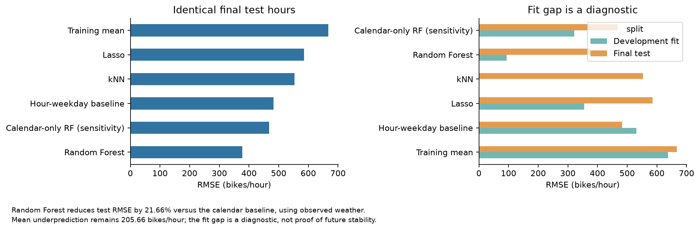
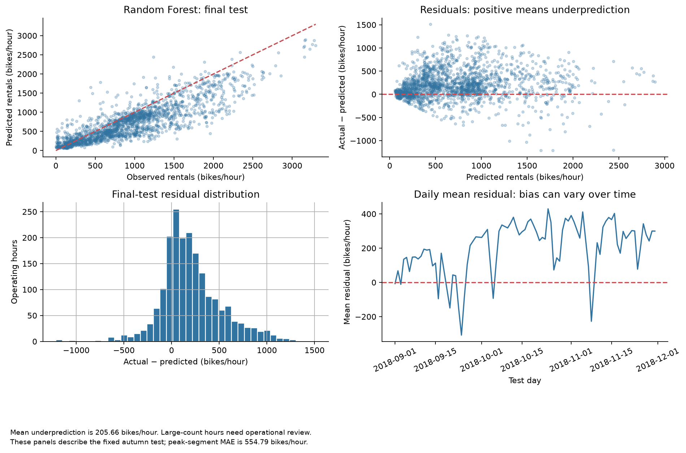

# Seoul bike demand review

Hourly bike-availability planning needs an estimate of demand and an understanding of where prediction errors matter. This project asks whether a regression model improves on a simple calendar rule, and whether that improvement is enough to justify further operational testing.

**Random Forest reduces held-out RMSE by 21.66%, but still underpredicts by 205.66 bikes/hour on average.** Its test RMSE is **377.83** and MAE is **275.16 bikes/hour**, across 1,937 operating hours. In the retrospective high-demand segment, MAE rises to **554.79**. The model uses observed weather for the target hour, so these results describe conditional historical prediction rather than a verified day-ahead forecast.



The calendar baseline records RMSE 482.28. The development-selected forest improves that average error, while its residuals expose systematic underprediction and busy-period misses. Station rebalancing, unmet demand and financial benefits cannot be measured from this citywide hourly dataset.



## Analysis and decision

Open [seoul_bike_machine_learning.ipynb](seoul_bike_machine_learning.ipynb). It leads with the problem and measured verdict, then examines demand patterns, model comparison, error concentration, input availability and the next decision. Each graph has an adjacent interpretation and an exported caption. The technical appendix documents the evaluation choices and corrections to the source analysis.

- Preserve all 8,760 raw hours and their operating status. Fit on 6,528 operating hours before September 2018; evaluate on the same 1,937 operating hours from September to November for every model.
- Select the candidate using expanding June, July and August validation windows, with a one-day gap. Fit preprocessing inside each training fold and keep the final test separate from tuning.
- Compare a training-mean rule, an hour-weekday rule, Lasso, kNN and Random Forest. Inspect a separately tuned calendar-only forest as an availability sensitivity.
- Report RMSE, MAE, R², signed error, segment errors, a paired test-day bootstrap and permutation diagnostics. Report closed hours with a separate all-hours denominator.

The recommendation is further conditional testing, with forecast-weather availability and busy-hour error tolerance resolved first. Only one annual cycle and one held-out autumn are available. No station inventory, current operating policy, accepted error cost or stakeholder-approved deployment threshold is supplied.

## Data and stack

The public [UCI Seoul Bike Sharing Demand dataset](https://archive.ics.uci.edu/dataset/560/seoul+bike+sharing+demand) covers 1 December 2017 to 30 November 2018. The bundled CSV retains its original bytes; the notebook checks its SHA-256 before fitting. [Data provenance](data/README.md) and [dataset licence and attribution](data/README.md#dataset-licence-and-attribution) explain the source and CC BY 4.0 terms.

The recorded runtime is Python 3.12.14 with pandas 3.0.1, scikit-learn 1.9.1, NumPy 2.3.5 and Matplotlib 3.11.2. Jupyter kernel and notebook-execution libraries are included. [requirements.txt](requirements.txt) pins the full active dependency closure, including notebook execution. Windows-specific dependencies use platform markers.

## Run independently

Everything needed for analysis is inside this project. Ordinary execution reads bundled data and does not download it. Install Python 3.12, then run these commands from the project root.

Windows PowerShell:

```powershell
py -3.12 -m venv .venv
.\.venv\Scripts\python.exe -m pip install -r requirements.txt
.\.venv\Scripts\python.exe .\run_notebook.py
.\.venv\Scripts\python.exe .\run_notebook.py --check
```

If the Windows `py` launcher is unavailable, replace `py -3.12` with the installed Python 3.12 executable. If library loading fails in a directory containing non-ASCII characters, use an ASCII project path.

macOS or Linux:

```bash
python3.12 -m venv .venv
.venv/bin/python -m pip install -r requirements.txt
.venv/bin/python run_notebook.py
.venv/bin/python run_notebook.py --check
```

The runner starts a temporary kernel using its active Python interpreter, executes every cell and independently recomputes final-test RMSE, MAE, R² and signed error for all six saved models on the same 1,937 operating hours. It also checks notebook execution, raw-data hashes, dependency versions, relative links and all six chart exports. A failed run removes the completion summary.

`results/execution_summary.json` consolidates the run settings, model comparisons, measured results, raw-data and notebook hashes, dependency versions and verification results. It records the notebook hash after the executed notebook is saved; the notebook does not write this summary itself.

`run_notebook.py --check` reads the saved public evidence without fitting models or writing files. It verifies the saved notebook hash and execution status, cell counts and errors, raw-data hashes, pinned installed dependencies, relative links, the two retained PNGs and final-test metrics from the retained row predictions. Both modes recompute metrics from the same 1,937 final-test prediction rows. The saved-artifact check covers fewer diagnostic artifacts than a full run and does not establish a new execution or business approval.

The notebook keeps all six charts embedded. The public `results/` folder retains the model-metric table, review predictions, two README charts and the consolidated summary. Full execution regenerates the other diagnostic tables, JSON records and four PNGs under ignored `.generated/`. Those optional files are not needed by `--check`. Optional notebook editing requires a Jupyter interface using the same environment.

## Attribution

This project adapts a group analysis project by Thanh Nguyen, Anh Dang, Nhat Nam Phan and Khoa Nguyen. The Python version revises preprocessing, tuning, baselines and interpretation.
